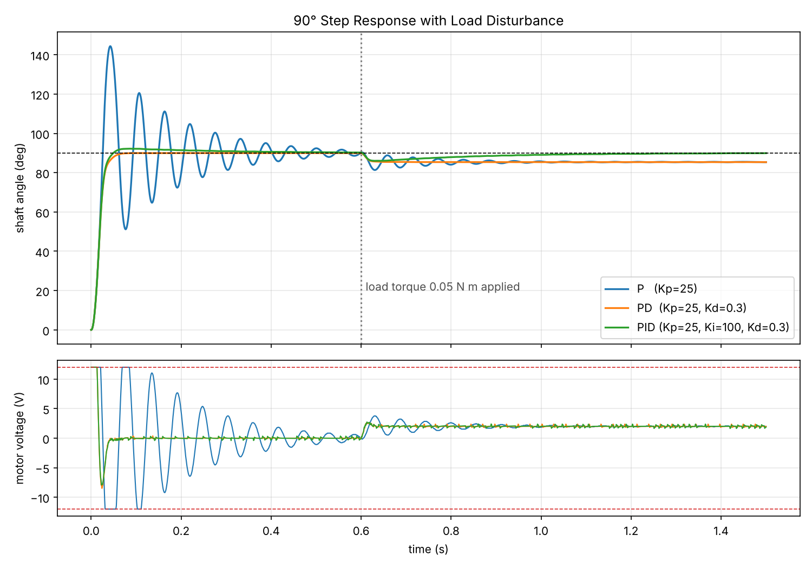
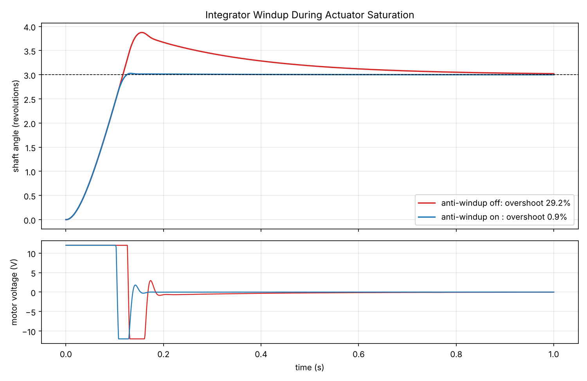

# PID Motor Simulator


Discrete PID position control of a DC motor with a 1 kHz loop, voltage saturation, anti-windup, filtered derivative, and encoder quantization. Includes a Streamlit app for interactive gain tuning.



## Results

90° step; 0.05 N·m load (17% of stall torque at 12 V) applied at 0.6 s; 2048-count encoder. Step metrics are computed before the load step. Error under load is the mean over the final 50 ms.

| Controller | Rise Time (ms) | Overshoot (%) | Settling Time, 2% (ms) | Error Under Load (deg) |
|---|---|---|---|---|
| P (Kp = 25) | 17 | 60.4 | 533 | 4.58 |
| PD (+ Kd = 0.3) | 24 | 0.0 | 52 | 4.63 |
| PID (+ Ki = 100) | 23 | 2.5 | 147 | 0.10 |

- **P:** fast but underdamped. The steady error under load equals R·τ/(K·Kp), verified in the tests.
- **PD:** the derivative term removes the oscillation. Load error is unchanged because dy/dt = 0 at rest.
- **PID:** the integral term drives the load error to near zero.
- The voltage ripple in the lower plot comes from one-count encoder steps passing through the derivative term; the derivative filter limits it.

### Integrator Windup



A 3-revolution move saturates the output at 12 V for about 0.1 s. Without anti-windup, the integrator accumulates error during saturation, causing 29.2% overshoot and a slow return. Clamping reduces overshoot to 0.9%.

## Model

Armature-controlled DC motor, state x = [θ, ω, i], input u = [V, τ_load]:

```
J·dω/dt = K·i − b·ω − τ_load
L·di/dt = V − R·i − K·ω
```

| R | L | K | J | b |
|---|---|---|---|---|
| 2 Ω | 1 mH | 0.05 N·m/A | 5×10⁻⁵ kg·m² | 1×10⁻⁵ N·m·s/rad |

The plant is discretized with a zero-order hold (`scipy.signal.cont2discrete`). The controller output is constant between samples, so for this linear plant the discrete model is exact at every sample, and each control step is a single 3x3 matrix update.

## Controller

`pidsim/pid.py` implements `u = Kp·e + Ki·∫e − Kd·dy/dt` with:

1. **Derivative on measurement** instead of error, so setpoint steps do not cause an output spike
2. **Low-pass filtered derivative** (2 ms time constant) to limit encoder noise amplification
3. **Output saturation** at the supply voltage
4. **Anti-windup by clamping:** integration pauses while the output is saturated and the error would increase saturation

## Getting Started (Mac or Windows, No Experience Needed)

You do not need to know Python. Each step says exactly what to click or type; copying and pasting is fine.

**1. Install Python (once per computer)**

- **Mac:** open Terminal (press Cmd+Space, type `Terminal`, press Return). Type `python3 --version` and press Return.
  - If it shows Python 3.9 or newer, go to step 2.
  - If a box offers to install the "command line developer tools", click **Install**, wait for it to finish, and check again.
  - Otherwise download the macOS installer from https://www.python.org/downloads/, open it, and click through.
- **Windows:** download the installer from https://www.python.org/downloads/ and open it. On the first screen tick **Add python.exe to PATH**, then click **Install Now**.

**2. Download this project**

Click the green **Code** button at the top of this page, then **Download ZIP**. Unzip it: on a Mac double-click the ZIP in Downloads; on Windows right-click it, choose **Extract All**, then **Extract**. You now have a folder named `PID-Motor-Sim-main`.

**3. Start it**

- **Windows:** open the `PID-Motor-Sim-main` folder and double-click **start.bat**.
- **Mac:** in Terminal type `cd ` (with a space after it), drag the `PID-Motor-Sim-main` folder from Finder into the Terminal window, and press Return. Then type `python3 start.py` and press Return.

The first time, it sets itself up: it creates a private Python environment inside the project folder and downloads the libraries it needs. This takes a few minutes and needs internet. Then a menu appears. Type a number and press Enter:

| Option | What it does | What you get |
| --- | --- | --- |
| 1 | Open the interactive PID tuner | Opens a page in your web browser with sliders for the gains, supply voltage and load; the step response updates as you drag. Press Ctrl+C in the Terminal or Command Prompt window to stop it |
| 2 | Regenerate the figures and results.md | Rebuilds the plots in `figures/` and the table in `results.md`, then opens one of the plots |
| 3 | Run the automated tests | Checks the motor model, controller and app against known results |

To use it again later, repeat step 3; setup is skipped and the menu appears in a few seconds. Type `q` and press Enter to quit.

**Troubleshooting**

| Problem | Fix |
| --- | --- |
| Mac: `command not found: python3` | Install Python (step 1). |
| Windows: `Python was not found`, or the Microsoft Store opens | Install Python from python.org (step 1) and tick **Add python.exe to PATH**. If you already installed it without that box, run the installer again, choose **Modify**, then **Next**, and tick **Add Python to environment variables**. |
| Windows: "Windows protected your PC" when opening start.bat | Click **More info**, then **Run anyway**. The file only runs `py start.py`; you can open it in Notepad to check. |
| `This project needs Python 3.9 or newer` | Install the current Python from https://www.python.org/downloads/ |
| The tuner did not open in the browser | Open http://localhost:8501 yourself while the window that started it is still running. |
| `Port 8501 is already in use` | A tuner is already running in another window. Close that window (or press Ctrl+C in it) and try again. |
| `Installing libraries failed` or setup stops with an error | Check your internet connection, delete the `.venv` folder inside the project folder, and start again. (On a Mac the folder is hidden: press Cmd+Shift+. in Finder to show it.) |
| A figure did not open by itself | Look in the project's `figures` folder. |

**For developers.** `start.py` only creates `.venv`, installs `requirements.txt` and runs the commands below, so you can also work by hand (Python 3.9 or newer):

```bash
# macOS / Linux
python3 -m venv .venv
source .venv/bin/activate
pip install -r requirements.txt
```

```powershell
# Windows (PowerShell or Command Prompt)
py -m venv .venv
.venv\Scripts\activate       # if PowerShell blocks this: Set-ExecutionPolicy -Scope CurrentUser RemoteSigned
pip install -r requirements.txt
```

```bash
python -m streamlit run app.py   # interactive tuner
python make_figures.py           # figures and results.md
python -m pytest                 # tests
```

`python start.py <shortcut>` runs one menu option directly (`python start.py --list` shows the shortcuts). CI runs the tests through `start.py` on macOS, Windows and Linux with Python 3.9 and 3.13.

### Command Line

The app deploys to Streamlit Community Cloud with `app.py` as the main file.

## Project Structure

```
start.py                    Beginner launcher: sets up .venv, shows the menu (start.bat on Windows)
pidsim/
  motor.py        state-space DC motor, ZOH discretization
  pid.py          discrete PID with saturation, anti-windup, filtered derivative
  sim.py          closed-loop simulation with encoder and load disturbance
  metrics.py      rise time, overshoot, settling time, steady-state error
app.py            Streamlit tuner
make_figures.py   figures and results table
tests/
```

## Tests

- **Plant:** open-loop speed matches K·V/(R·b + K²); stall is an exact equilibrium
- **Metrics:** overshoot matches exp(−πζ/√(1−ζ²)) for an analytic second-order response; rise and settling times match τ·ln 9 and τ·ln 50 for a first-order response
- **Controller:** P-only load error matches R·τ/(K·Kp); integral action removes it; output stays within the supply; no derivative kick; anti-windup reduces overshoot; final error is within one encoder count
- **App:** runs headlessly through Streamlit's testing API and responds to slider input

## License

MIT
